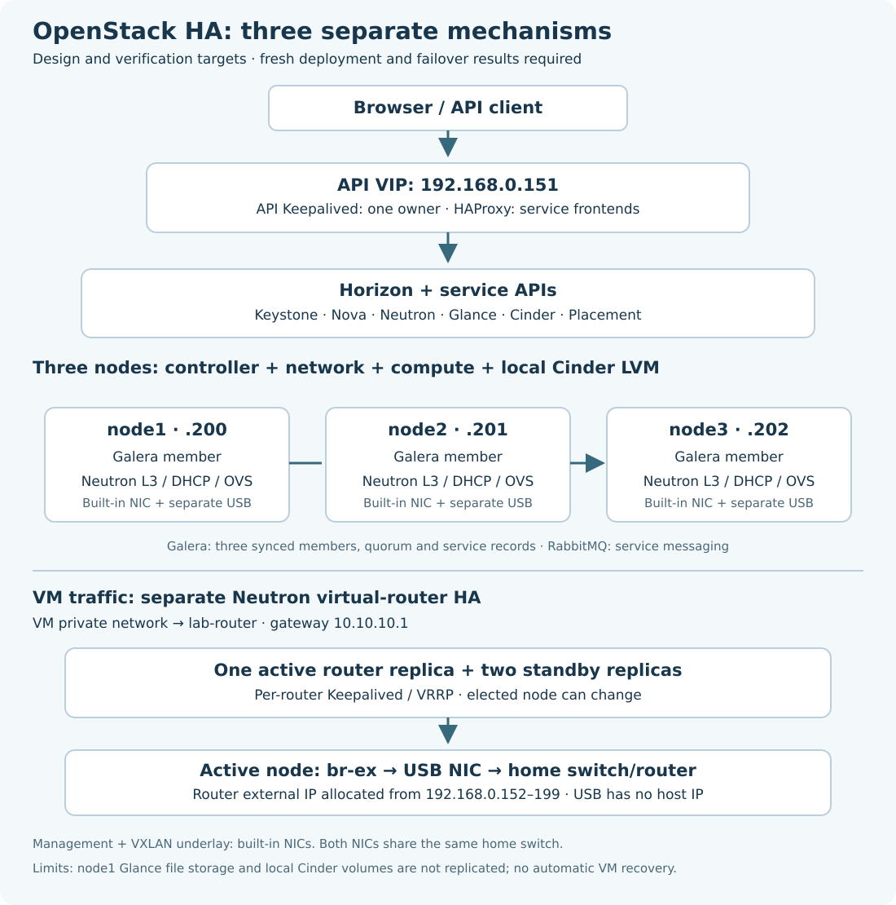

# OpenStack from zero — three-node HA lab

Build OpenStack 2026.2 with Kolla-Ansible 23.0.0 on three Ubuntu 24.04 nodes. Learn each component, run one explained step from R2d2, and review its report before continuing.

**Design:** API Keepalived + HAProxy, three-member MariaDB/Galera, and Neutron virtual-router HA. The course scripts and checks require this design. Deployment and failover results must come from the fresh installation; they are not assumed.



## Where each HA feature is configured and verified

| Feature | Configure | Install/create | Verify |
|---|---|---|---|
| API VIP `192.168.0.151`, Keepalived + HAProxy | [Phase 2 E](docs/phase-02/E-configure-lab.md) | [Phase 3 C](docs/phase-03/C-deploy-openstack.md) | Container/VIP observations in Phase 3 C; HTTPS in D; controlled failover in Phase 5 |
| MariaDB/Galera on all three nodes | Phase 2 E and three-node inventory | Phase 3 C | Three Synced/Primary members and shared UUID in Phase 3 C; controlled failover in Phase 5 |
| Virtual-router HA | Phase 2 E enables Neutron agent HA | Phase 3 C deploys agents; [Phase 4 B](docs/phase-04/B-create-networks.md) creates the HA router | One active and two standby router agents in Phase 4 B; Guest traffic in Phase 4 D; controlled failover in Phase 5 D |

Three nodes provide the places to run replicas. Each service still needs its own HA configuration and test.

## Lab

| Machine | Address | Role |
|---|---|---|
| R2d2 | Observed `192.168.162.131/24`, VMware NAT/DHCP | Management tools, scripts and private reports |
| node1 | `192.168.0.200/24` | Controller, network, compute, local Cinder LVM |
| node2 | `192.168.0.201/24` | Controller, network, compute, local Cinder LVM |
| node3 | `192.168.0.202/24` | Controller, network, compute, local Cinder LVM |

All nodes use `enp0s31f6` for management/API traffic and the VXLAN underlay. Separate per-node USB NICs attach to `br-ex` for external VM traffic. Both NICs share the home switch/LAN; there is no physical network isolation or redundant home switch.

The reviewed resource snapshot showed four CPU cores and about 15 GiB usable RAM per node, with 6.3/6.6/7.1 GiB available respectively and no active swapping during the short sample. That is initial headroom, not a workload or failure-capacity guarantee. Measure again after adding HA routers and a guest.

## Current learning step

Phase 4 is complete: reviewed live reports passed VM networking and Cinder data persistence across detach/reattach. The VM and volume remain on independent compute/storage hosts; this is not storage HA. Browser sign-in is a separate user-confirmed check.

Next: [Phase 5 — HA validation and VM migration](docs/phase-05/README.md). Begin with fresh readiness checks, then API VIP, MariaDB, virtual router and planned VM migration. The API VIP, one-member MariaDB and virtual-router HA tests passed, including restoration. Network interruption was observed during router takeover; uninterrupted service is not claimed. Next is Chapter E — planned VM migration. Its read-only inspection script is ready; destination selection and migration remain pending. Ceph and automatic VM recovery are deferred.

## Course

| Phase | Guide |
|---|---|
| 1 — Host prerequisites | [Ubuntu, access, NICs and reviewed Cinder disks](docs/phase-01/README.md) |
| 2 — Management environment | [Tools, inventory, HA settings and HTTPS certificates](docs/phase-02/README.md) |
| 3 — Install OpenStack | [Full prechecks, HA deployment, access and verification](docs/phase-03/README.md) |
| 4 — Networking and first VM | [HA router, VM ingredients, guest traffic and volumes](docs/phase-04/README.md) |
| 5 — HA validation and VM migration | [Readiness, three HA exercises and planned migration](docs/phase-05/README.md) |
| 6 — Application | Planned after Phase 5 |
| 7 — Monitoring | Planned after the application |

[Architecture and limits](docs/architecture.md) · [Viewing-command glossary](docs/command-glossary.md) · [Goal and learning plan](docs/00-goal-and-plan.md)

## Fresh installation on the existing prepared hosts

Read the exact destructive scope in [Fresh installation](docs/fresh-install.md). The reset removes OpenStack service data and Cinder logical volumes, retaining Ubuntu, management access, the reviewed SATA PV/VGs, R2d2 tools, CA and credentials. Joe runs it; the assistant does not access the lab.

```bash
cd ~/openstack-from-zero
git pull --ff-only
/usr/bin/python3 scripts/phase3-reset.py
```

After reviewing that plan and the guide:

```bash
/usr/bin/python3 scripts/phase3-reset.py --apply
```

Return the resulting report before prechecks/deployment. The reset does not start installation automatically.

## HA limits

API redundancy, database replication and virtual-router takeover are separate from VM recovery and storage replication. Glance uses node1's local file storage. Cinder uses independent local SATA pools. A failed compute node's VMs are not automatically restarted elsewhere. The shared switch/home router remain common dependencies. These limits are part of the lab design.

Keep `private/`, `reports/`, passwords, cloud profiles, CA private keys and SSH private keys out of Git. Never post credentials in chat.
