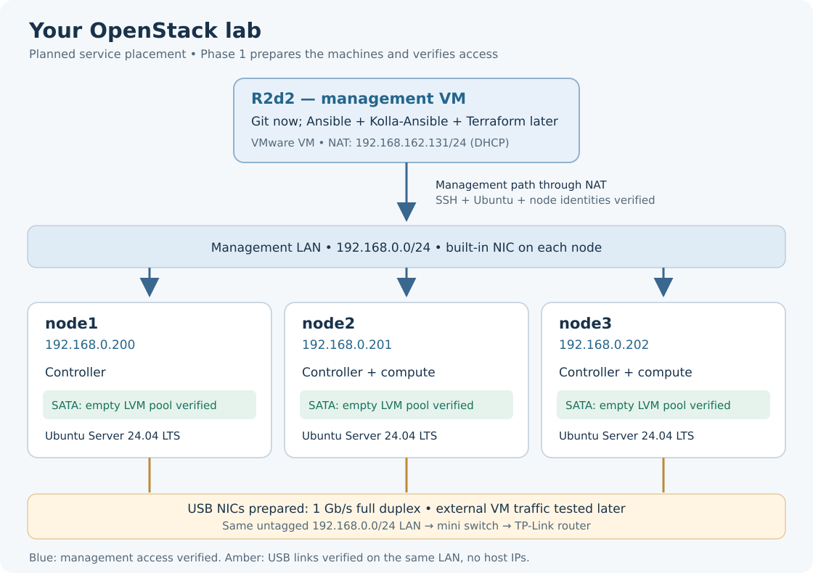

# OpenStack from zero

Build a cloud you understand. Deploy an application. Monitor it.

**Current phase: [Phase 2 — Management environment](docs/phase-02/README.md). [Chapter A is reviewed](docs/phase-02/A-check-r2d2.md#5-reviewed-result); [Chapter B's versions are agreed](docs/phase-02/B-select-versions.md); Chapter C's installation/activation is complete; Chapter D's inventory/access checks are complete; run [Chapter E — Configure the lab](docs/phase-02/E-configure-lab.md).**

**Rebuilding from the beginning? [Phase 1 — Prerequisites](docs/phase-01/README.md)** keeps every completed step and lesson.

| Phase | Goal | Guide |
|---|---|---|
| **1. Prerequisites** | Ubuntu, management access, NIC and disk identification | **[Read Phase 1](docs/phase-01/README.md)** |
| **2. Management environment** | Prepare Ansible, Kolla-Ansible and their configuration on R2d2 | **[Read Phase 2](docs/phase-02/README.md)** |
| 3. Install OpenStack | Deploy and check cloud services | Planned |
| 4. First VM | Test VM networking and volumes, then introduce Terraform | Planned |
| 5. Deploy an app | PostgreSQL, Flask and Nginx | Planned |
| 6. Monitoring | Prometheus, Grafana and alerts | Planned |

[Goal and learning method](docs/00-goal-and-plan.md)

Each step: **purpose → explain the script → run → review the result → short lecture**.

**Current checkpoint:** SSH-key setup passed on all three nodes with fresh key-only logins. Read **[Chapter E — the successful result and short lesson](docs/phase-01/E-ssh-keys.md#7-reviewed-result)**. The complete setup steps remain visible. **[Chapter F — node names on R2d2](docs/phase-01/F-r2d2-hosts.md#5-reviewed-result)** also passed: all three names resolve correctly. Its result and short lesson are published. **[Chapter G — Chrony on R2d2](docs/phase-01/G-r2d2-chrony.md#6-reviewed-result)** is also complete: active, enabled and initially synchronized. Its result and short lesson are published. **[Chapter I — SATA inspection result and lesson](docs/phase-01/I-cinder-storage.md#5-reviewed-inspection-result):** collection and review completed on all three nodes. **[Chapter J — LVM pools created and verified](docs/phase-01/J-cinder-lvm.md#6-reviewed-creation-result)** on all three nodes: one SATA PV and zero LVs per pool; Ubuntu/system LVM unchanged. The setup commands, reviewed result, short lesson and read-only viewing command remain available. **Phase 2 is now published:** Chapter A's read-only inspection is complete, with its result and short lesson published. Chapter B's version set and environment path are agreed. Chapter C's installation and activation are confirmed. Chapter D's access checks passed on all nodes. The update to use all three as computes is verified. Chapter E's local configuration guide and script are ready; Chapter F remains a draft. No Phase 2 installation is claimed.
