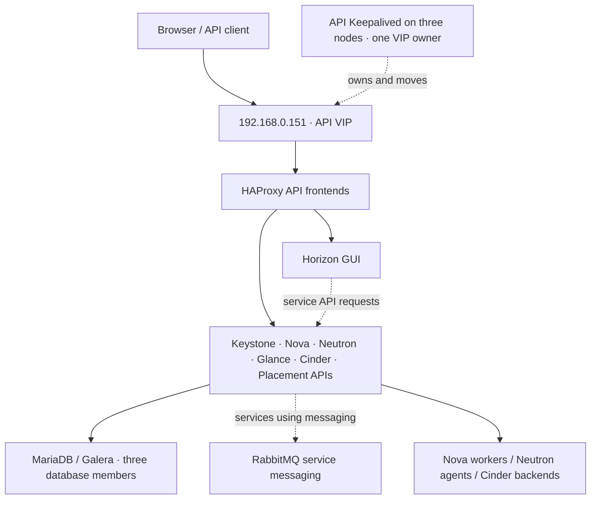
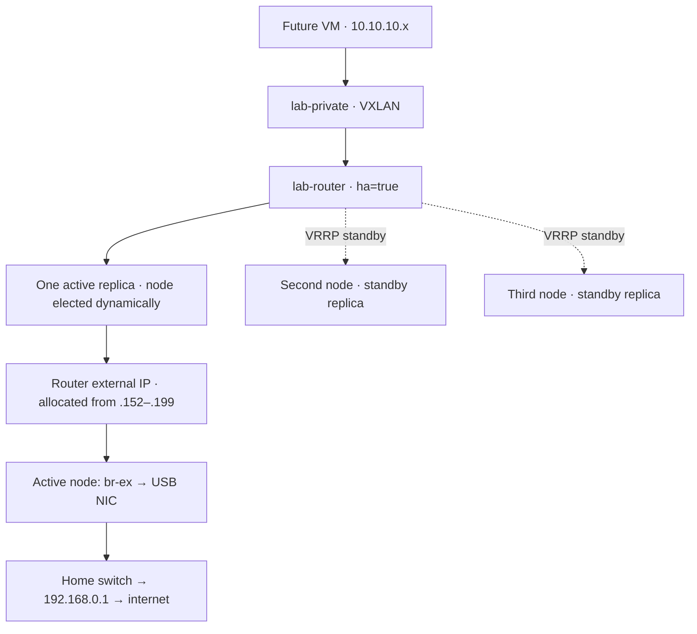

# Three-node OpenStack HA architecture

[Home](../README.md) · [HA installation](phase-03/README.md) · [Virtual networks](phase-04/README.md)

All three nodes run controller, network, compute and independent local Cinder LVM roles. The three HA features below protect different parts of the cloud.

## 1. Browser and API access

Your browser connects to the VIP to reach Horizon. API clients also use that VIP, with each service's HTTPS port. Keepalived places the API VIP on one controller at a time. HAProxy forwards requests to the configured service backends. The VIP is not a VM router address.

Glance is the image service alongside the other APIs. It is not the common destination through which Keystone, Nova and Neutron all pass. Nova compute uses libvirt/KVM to run guests. Neutron agents use Open vSwitch and Linux networking to implement VM networks. MariaDB stores service records; RabbitMQ carries messages for services that use it.

## 2. Database HA

MariaDB/Galera runs on node1, node2 and node3. A healthy initial cluster reports `Synced`, `Primary`, size `3`, connected/ready ON and one shared cluster UUID. ProxySQL supplies database connection routing. A single failed member leaves two members for quorum when the cluster and network are healthy; that behaviour must be tested. Do not power off two members together as a basic HA test.

## 3. Virtual-router HA and USB connections

The **same logical router** is scheduled to three L3 agents: one active and two standby. Neutron manages per-router Keepalived/VRRP separately from the API Keepalived container. A standby promotes itself when the relevant router HA heartbeats are lost. Simply stopping the L3 agent may leave its Keepalived process running and therefore is not, by itself, a reliable failover test.

The router's private gateway is `10.10.10.1`. Its external IP is allocated during creation and recorded in the report; do not pin an old address or active node. Standby replicas must not be mistaken for three independent external gateways. The USB host interfaces remain unnumbered.

Private VM traffic between nodes, including traffic from a VM to a router active on another node, travels through VXLAN over the built-in management NICs. External VM traffic leaves through the active router node's USB NIC. The hidden Neutron HA network also uses the configured overlay; it does not require a third physical NIC in this lab.

## 4. Where the features enter the course

| Feature | Phase 2 E settings | Phase 3 C deployment | Phase 4 B |
|---|---|---|---|
| API HA | `enable_haproxy: true`, `enable_keepalived: true` | HAProxy and API Keepalived containers, VIP | Already present |
| Database HA | `enable_mariadb: true`; inventory includes all three nodes | Bootstrap Galera and verify all three members | Already present |
| Router HA | `enable_neutron_agent_ha: true`, `max_l3_agents_per_router: 3`, `dhcp_agents_per_network: 2`, DVR off | Deploy HA-capable Neutron agents/configuration | Create router with `ha: true`; verify active/standby placement |

DHCP redundancy uses two agents per private network. It is separate from the three router replicas.

## 5. What this design does not provide

- Glance file storage remains on node1; image-storage HA requires a different storage design.
- Each Cinder LVM backend stores volumes on its own SATA disk; another node does not hold a replicated copy.
- Router/API takeover does not migrate or automatically restart a VM whose compute node failed.
- Both NICs connect to one home switch/router, so those physical devices remain common failure points.
- A healthy snapshot is not a failover result. API, database and router takeover tests are separate, controlled exercises.

[Neutron OVS/VRRP architecture](https://docs.openstack.org/neutron/latest/admin/deploy-ovs-ha-vrrp.html) · [Kolla Neutron HA](https://docs.openstack.org/kolla-ansible/2026.2/reference/networking/neutron.html)
