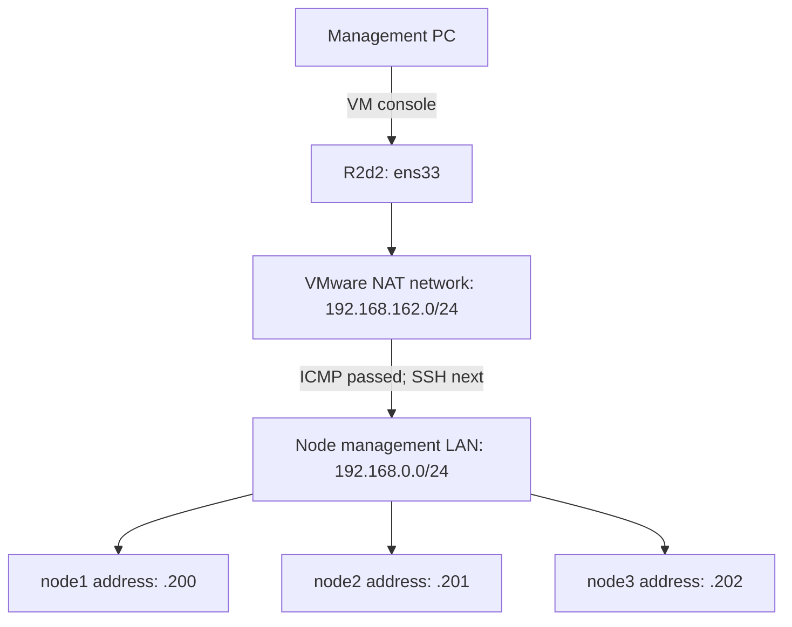

# 1.1 — Install R2d2

[Phase 1](README.md) · [Next: check access](03-access-check.md)

**Status: complete.** Confirmed from your terminal output on 22 October 2026.

| Check | Observed result |
|---|---|
| Hostname and account | `r2d2`, `joe` |
| Operating system | Ubuntu 24.04.5 LTS, x86-64 |
| Virtual machine | VMware; NAT mode stated in the lab plan |
| Network interface | `ens33` |
| IPv4 address | `192.168.162.131/24`, assigned by DHCP |
| Reachability | Ping replies from `192.168.0.200`, `.201` and `.202` |

The exact VMware product is not established by `hostnamectl`. The node operating systems and SSH access still need verification.

## Short lecture — what your result means

R2d2 has an address on `192.168.162.0/24`. Your intended nodes are on `192.168.0.0/24`. Successful pings show that R2d2 can exchange ICMP traffic with those three addresses across the network boundary.

SSH is a separate check: it must connect to port 22, authenticate your account and read each node's actual identity.

The diagram shows the logical path. The DHCP address can change; the script records the address actually in use.

**Next:** [1.3 — Check access from R2d2](03-access-check.md). This checks the existing node installations before deciding whether any installation work remains.

Installation choices — completed reference

1. Download [Ubuntu Server 24.04 LTS amd64](https://releases.ubuntu.com/24.04/).
2. Attach the ISO to the management VM and select NAT networking.
3. Install Ubuntu with hostname `r2d2`, your local account, the VM's intended OS disk and **Install OpenSSH server** selected.
4. Check the disk summary, complete installation, detach the ISO and reboot.
5. Sign in through the VM console.

Initial management-PC access can use the VM console. Direct SSH from the PC depends on the actual VMware networking settings.

Reference: [Ubuntu Server installer](https://canonical-subiquity.readthedocs-hosted.com/en/latest/howto/basic-server-installation.html).

