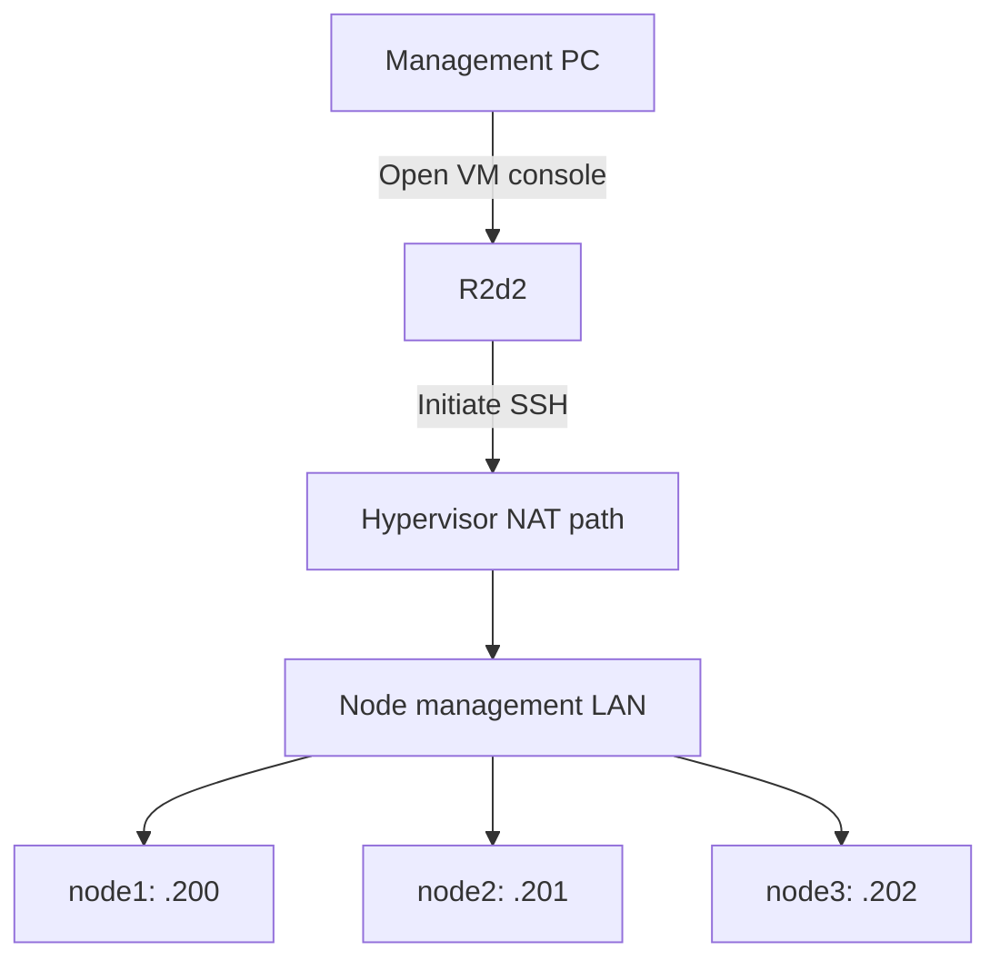

# 1.1 — Install R2d2

[Phase 1](README.md) → **R2d2** → [Ubuntu nodes](02-ubuntu-nodes.md)

**Purpose:** create the management machine that will send commands to the three nodes.

## Steps

1. Download the **Ubuntu Server 24.04 LTS amd64** installation image from [Ubuntu's 24.04 releases](https://releases.ubuntu.com/24.04/).
2. Attach it to the R2d2 VM. Keep the VM's network adapter in your chosen **NAT** mode.
3. Boot the VM and choose the normal Ubuntu Server installation.
4. Use these choices:

| Installer setting | Choice |
|---|---|
| Hostname | `r2d2` — Linux hostname for R2d2 |
| Username | `joe` is the course example; use your chosen account |
| Network | Accept the NAT network's DHCP address |
| Disk | The VM's intended OS disk |
| SSH | Select **Install OpenSSH server** |
| Extra server applications | Leave unselected for this phase |

5. Check the installer disk summary, finish installation, detach the ISO and reboot.
6. Sign in through the **VM console** using the account you created.

For this course, Ubuntu 24.04 on R2d2 is a recommended baseline. Its installed version and address will be recorded by the inspection script.

## Success check

You can sign in at R2d2's console and see its shell prompt.

Access from your management PC initially uses the hypervisor's VM console. Exact SSH instructions from that PC depend on which hypervisor provides NAT and how it exposes the VM; we will use its actual settings.

## Short lecture — after the checkpoint

R2d2 is your administration machine. Later, Ansible runs here and connects to the nodes over SSH.

This is the **intended connection path**; Chapter 1.3 tests it. NAT alone does not prove that R2d2 can reach the node LAN.

The NAT network gives R2d2 its VM-side address. The nodes keep their own management addresses. The hypervisor's NAT DHCP service and your physical LAN's DHCP service may be different.

**Next:** [1.2 — Install the Ubuntu nodes](02-ubuntu-nodes.md).

Reference: [Ubuntu Server installer](https://canonical-subiquity.readthedocs-hosted.com/en/latest/howto/basic-server-installation.html).
