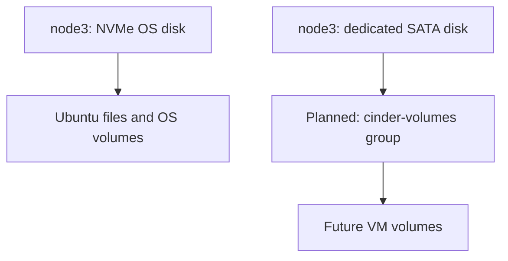

# 1.4 — Prepare the two NICs and Cinder storage

[Phase 1](README.md) · [Previous: access check](03-access-check.md)

**Purpose:** use the inspection report to configure the intended adapters and prepare the intended storage disk.

## A. Review the two NICs

| Adapter | Intended job | Host address |
|---|---|---|
| Built-in NIC | Management and internal cloud communication | Node's .200, .201 or .202 address |
| USB NIC | Neutron's external VM connection | No host IPv4/IPv6 address |

Review the actual interface names, MACs and links from all three nodes. The report identifies USB-backed interfaces from Linux's device paths. It does not assume old adapter assignments or rename them.

Before the persistent NIC configuration, establish:

- Which hypervisor supplies R2d2's NAT network.
- Which router/server supplies the **node LAN's** DHCP service, plus its range, gateway and DNS.
- Where the USB NICs are cabled and which external network they will serve.

**Checkpoint:** after that review, the next update supplies the exact network script and explains its effects before you run it. Final configuration must preserve SSH access and leave the provider NIC without a host address.

## B. Review node3's Cinder disk

Review the report's disk model, serial, capacity, stable `/dev/disk/by-id/` path and current partition/mount information. We must identify the current disk before prescribing an LVM operation.

A rootless inventory may not show every storage signature or owner. The storage preparation will also check current mounts, swap, existing filesystem/LVM/RAID ownership and the OS backing devices with appropriate administrator access.

**Checkpoint:** the exact disk operation and target are reviewed before creation of `cinder-volumes`. No erase or LVM creation command is supplied at this inspection step.

## Success check for the completed host preparation

Management access still works after permanent NIC configuration. The USB adapters match the intended identities and have no host addresses. Node3's verified SATA disk backs `cinder-volumes`, separately from Ubuntu.

Those are future execution checks. The access report alone does not mark them complete.

## Short lecture — after the completed preparation

**LVM** manages disk capacity as a pool. **Cinder** asks that pool to create VM volumes.

The planned pool is local to node3. A volume on it is not automatically copied to the other controllers.

Kolla's Cinder documentation notes limitations with LVM in a multi-controller setup. We keep its prechecks enabled and require a working volume test from both computes before placing application data on this backend.

**Next:** finish Phase 1's checks, then prepare the management environment in Phase 2.

Reference: [Kolla Cinder LVM guide](https://docs.openstack.org/kolla-ansible/2026.1/reference/storage/cinder-guide.html#lvm).
