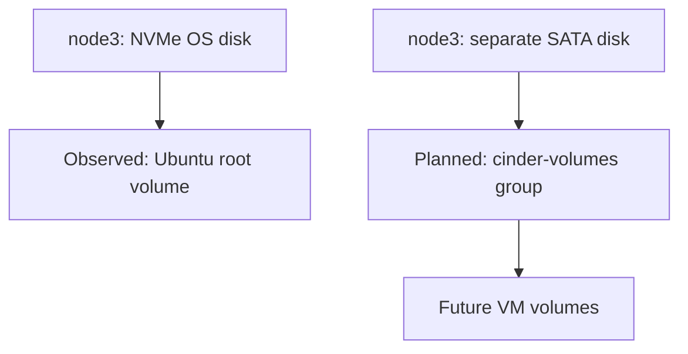

# 1.4 — Prepare the two NICs and Cinder storage

[Phase 1](README.md) · [Previous: SSH result and lesson](03-access-check.md)

**Current step:** confirm the physical network plan, then configure the USB adapters. Cinder storage follows that network step.

## A. What the inspection established

The built-in management NIC is `enp0s31f6` on all three nodes. It carries `.200/24`, `.201/24` and `.202/24` respectively. All three have configured gateway and DNS `192.168.0.1`.

| Node | USB NIC | Observed MAC |
|---|---|---|
| node1 | `enx00e04c557e58` | `00:e0:4c:55:7e:58` |
| node2 | `enx00e04c2c1678` | `00:e0:4c:2c:16:78` |
| node3 | `enx00e04c304688` | `00:e0:4c:30:46:88` |

All three USB adapters are detected, administratively **DOWN**, and have no host addresses.

**Short lesson:** an administratively down adapter is disabled. This report does not establish its physical cable/link status. The built-in NIC already provides working SSH access; the USB adapter will provide the external VM connection.

## B. Two network details to confirm

1. Are the three USB adapters plugged into the **same switch/LAN** as the built-in management NICs, or a different network?
2. Which device runs DHCP on `192.168.0.0/24` — router/server brand or software — and what address range does it allocate?

Cabling determines where VM traffic will go. The DHCP range is needed to choose later cloud addresses without conflicting leases. A configured gateway/DNS address does not identify the DHCP service or its pool.

**Next deliverable:** one explained network script using the observed MACs, preserving management access and leaving the USB adapters without host addresses. Persistent settings must be checked against the actual existing network configuration before activation.

## C. Cinder storage — identified for the following step

The report shows Ubuntu's root volume on **NVMe** on every node. Node3 also has this SATA candidate:

| Item | Observed value |
|---|---|
| Current Linux path | `/dev/sda` |
| Model | `KINGSTON SA400S3` |
| Serial | `50026B768317883A` |
| Capacity | `240057409536` bytes — approximately 240 GB |
| Filesystem / mount / child partitions | None shown by `lsblk` |

Stable identifier: `/dev/disk/by-id/ata-KINGSTON_SA400S37240G_50026B768317883A`.

The inventory identifies the candidate; it does not establish full ownership or disk health. Before provisioning, the storage step will verify the current device, mounts, swap, filesystem/LVM/RAID ownership, OS backing devices and health evidence with administrator access.

The exact target and operation are reviewed before creating `cinder-volumes`.

**Short lesson:** Ubuntu's LVM holds the operating system. The planned Cinder LVM pool holds VM volumes on the separate SATA disk. Those local volumes are not replicated across controllers.

Kolla documents LVM limitations with multiple controllers. Keep its prechecks enabled and verify volume access from both computes before deploying application data.

**Current action:** answer the two network details in section B. Network configuration comes next, then the Cinder preparation step.

Reference: [Kolla Cinder LVM guide](https://docs.openstack.org/kolla-ansible/2026.1/reference/storage/cinder-guide.html#lvm).
