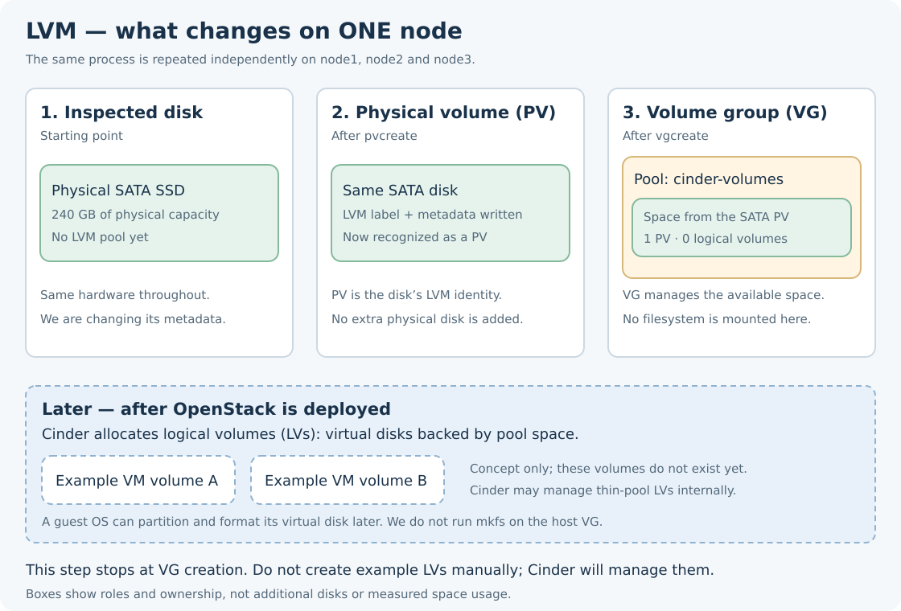
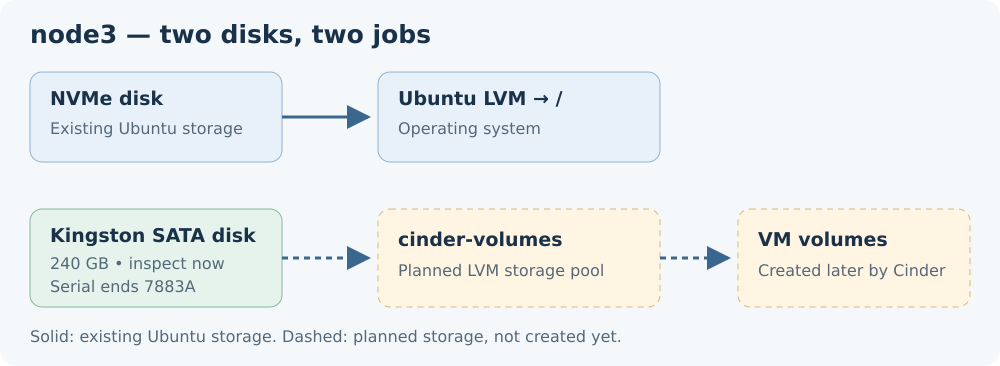

# 1.6 — Create the three Cinder LVM pools

[Phase 1](README.md) · [Previous: reviewed disk inspection](05-cinder-storage.md#5-reviewed-inspection-result)

**Goal:** create one empty `cinder-volumes` storage pool on each node's reviewed SATA disk.

**Status: complete.** Joe's apply report confirms pool creation and verification on all three nodes. The purpose, script explanation and original commands remain below for study and rebuilding.

## Before running — understand LVM step by step

LVM means **Logical Volume Manager**. It manages disk space so software can allocate virtual disks from a pool.



### Step A — Start with the physical disk

Each node has two separate physical disks: NVMe for Ubuntu, and the inspected 240 GB SATA SSD for this storage step. The same SATA disk remains the hardware underneath every LVM layer.

We use the whole SATA disk as the LVM device. We are not adding a partition table or creating a new physical disk.

### Step B — Prepare the physical volume (PV)

`pvcreate` writes an LVM label and metadata to the selected disk. That tells Linux, “this disk can supply space to LVM.”

**PV means physical volume:** in this lab, it is the SATA disk prepared for LVM. This is not an ext4 filesystem and it does not create a folder or a VM disk.

### Step C — Create the volume group (VG)

`vgcreate` creates the named storage pool and assigns the PV to it.

**VG means volume group.** Our name is `cinder-volumes`. A VG can use multiple PVs, but our agreed layout uses **one SATA PV per node's VG**.

The pool is a source of capacity, somewhat like the capacity you allocate virtual disks from in VMware. LVM itself is not a VMFS-style filesystem or datastore mount.



The same VG name can exist on separate hosts. `node1:cinder-volumes` and `node2:cinder-volumes` refer to different local pools. This does not create one shared 720 GB pool or copy data between nodes. The Cinder cluster-name setting is separate from the VG name.

### Step D — Logical volumes (LVs) come later

**LV means logical volume:** a virtual block device allocated from LVM-managed space.

After OpenStack is deployed, Cinder manages the logical volumes for VM storage. Depending on its configured LVM mode, it may also manage a thin pool internally. We do not create example LVs by hand in this step.

A VM can later see an attached Cinder volume as a virtual disk and use its own partitions and filesystem. We do not format or mount the host's `cinder-volumes` VG.

### What changes when this script finishes?

| Item | Before preparation, from your inspection | Expected after successful preparation |
|---|---|---|
| Physical SATA SSD | One per node, 240 GB each | Same physical disk |
| SATA LVM identity | Not an existing PV | One initialized PV |
| SATA pool | No `cinder-volumes` VG | One `cinder-volumes` VG per node |
| Logical volumes in that pool | None | Still none; zero LVs |
| Ubuntu `ubuntu-vg` and NVMe | Existing operating-system storage | Unchanged |

The allocatable pool capacity is slightly below the physical disk capacity because LVM needs metadata and alignment space. Linux may display approximately **223.6 GiB** for a disk sold as **240 GB**; those use different units.

### Understand the two write commands

**Reference only:** these are the operations the helper runs as root on node1, after its checks. Do not run them manually as an extra step.

```bash
pvcreate /dev/disk/by-id/ata-KINGSTON_SUV400S37240G_50026B7766070422
vgcreate cinder-volumes /dev/disk/by-id/ata-KINGSTON_SUV400S37240G_50026B7766070422
```

In the first command, the argument is the reviewed physical disk. In the second, `cinder-volumes` is the new pool name and the final argument is the PV supplying its space. The script uses node2's and node3's own confirmed disk identifiers on those machines.

The helper also reads the following reports; you do not need to type these separately:

| Tool | What you learn |
|---|---|
| `pvs` | Which disks/partitions are PVs and which VG owns each |
| `vgs` | Which storage pools exist |
| `lvs` | Which logical volumes exist inside those pools |

The one command you run from R2d2 is still the wrapper in **section 4** below. It performs these checks and operations in order and saves one combined report.

## 1. Agreed Kolla design

The reviewed Kolla-Ansible **2026.1** documentation supports LVM volume groups on storage nodes. Its default Cinder check also requires a cluster name when the inventory has multiple `cinder-volume` hosts. However, Cinder's LVM driver does not support active/active clustering, and Cinder rejects a cluster name with that driver.

Three independent local LVM backends need the documented exception to **that Cinder cluster check**, with the Cinder cluster name left empty. The agreed later deployment settings are:

```yaml
cinder_cluster_name: ""
cinder_cluster_skip_precheck: true
```

These settings do not enable replication. The exception skips the Cinder cluster-name check; it does not disable the LVM volume-group check or all Kolla prechecks. **Joe approved this specific exception and the independent-pool design.** The scripts below prepare disk pools only; these Kolla settings will be applied in the later deployment-configuration chapter.

**The pool-creation step is now authorized.** Read sections 2 and 3, then run the apply command in section 4 on R2d2. The optional read-only plan command remains available.

This source review uses 2026.1 as a reference. The deployment release on rebuilt R2d2 has not been established; its installed code and rendered inventory/configuration must be checked in the management-environment phase before deployment. No working three-node Cinder deployment is claimed here.

Source review: [Kolla Cinder guide](https://docs.openstack.org/kolla-ansible/2026.1/reference/storage/cinder-guide.html) · [Kolla checks](https://github.com/openstack/kolla-ansible/blob/stable/2026.1/ansible/roles/cinder/tasks/precheck.yml) · [Kolla Cinder template](https://github.com/openstack/kolla-ansible/blob/stable/2026.1/ansible/roles/cinder/templates/cinder.conf.j2) · [LVM driver](https://github.com/openstack/cinder/blob/stable/2026.1/cinder/volume/drivers/lvm.py) · [Base driver capability](https://github.com/openstack/cinder/blob/stable/2026.1/cinder/volume/driver.py) · [Cinder cluster validation](https://github.com/openstack/cinder/blob/stable/2026.1/cinder/volume/manager.py).

## 2. Which disks will change?

| Node | SATA serial | Stable target under `/dev/disk/by-id/` |
|---|---|---|
| node1 | `50026B7766070422` | `ata-KINGSTON_SUV400S37240G_50026B7766070422` |
| node2 | `4P3521354988` | `ata-ADATA_SU630_4P3521354988` |
| node3 | `50026B768317883A` | `ata-KINGSTON_SA400S37240G_50026B768317883A` |

Each target was observed as 240,057,409,536 bytes. The script checks hostname, Ubuntu version, management IP, serial, size and SATA transport again. It does not select a disk just because its name is `/dev/sda`.

**Apply mode writes LVM metadata to these disks.** This is real storage preparation, not a simulation. Your existing Ubuntu `ubuntu-vg` and NVMe disks are excluded. The script does not mount a filesystem, create VM volumes or start Cinder.

## 3. What the script does

Run [phase1-lvm.sh](../../scripts/phase1-lvm.sh) on **R2d2 as joe**. It sends [phase1-lvm-node.py](../../scripts/phase1-lvm-node.py) through SSH and sudo to each selected node.

| Stage | Purpose |
|---|---|
| Inspect again | Check exact disk identity, partitions, mounts, fstab, swap, holders, signatures and current LVM ownership |
| Protect Ubuntu | Check the backing disks of `/`, `/boot` and `/boot/efi`; record existing system LVM identities |
| Save evidence | Before a change, save a private state record under `/var/lib/openstack-from-zero/lvm/` on that node |
| `pvcreate <stable-disk-path>` | Initialize the reviewed SATA disk as an LVM physical volume |
| `vgcreate cinder-volumes <stable-disk-path>` | Put that physical volume into a new storage pool |
| Verify | Confirm one SATA PV and zero LVs in the pool, with Ubuntu mounts and system LVM identities unchanged |
| Report | Save one private combined report under `reports/` on R2d2 |

The evidence file is **not a backup of disk contents**. The script uses no force flags, formatting or signature-erasure commands. An unexpected signature, disk owner, mount or nonempty pool stops the operation for review. It cannot automatically answer an overwrite prompt.

A matching existing empty pool is verified without recreating it. If only the selected unassigned PV exists, it can finish the VG step. It stops on the first node needing review; completed changes on earlier nodes remain. There is no automatic disk rollback. This preparation script is for the empty-pool stage, not for modifying pools after Cinder has created volumes.

Prompts: the key-unlock prompt takes your SSH-key passphrase; sudo takes joe's Ubuntu login password **on the node currently shown**. No packages are installed and no Kolla configuration is changed.

## 4. Commands on R2d2

Download the chapter and script:

```bash
cd ~/openstack-from-zero
git pull --ff-only
```

To check the plan without disk writes:

```bash
bash scripts/phase1-lvm.sh --user joe --node all
```

Expected plan marker: `RESULT: LVM_PLAN_READY for all`.

**Joe has approved the section 1 decision.** To create the three pools now, run:

```bash
bash scripts/phase1-lvm.sh --user joe --node all --apply
```

`--apply` permits the two explained LVM creation operations. Do not put sudo before this wrapper. It uses sudo only on the selected nodes. For a later single-node run, replace `all` with `node1`, `node2` or `node3`.

## 5. Return the result

Each node must show `RESULT: CINDER_LVM_READY` followed by its hostname. Final success is:

```text
RESULT: CINDER_LVM_READY for all
```

Use the printed `cat` command to display the report and send it back. Stop for review before moving to the next chapter. A created pool is not proof that OpenStack volume creation or attachment works; that is tested after deployment.

## 6. Reviewed creation result

Joe's report `phase1-lvm-20261023T114712Z-Oyo7Ks.txt` used **`Apply disk changes: true`**. This was an apply run, not just a precheck.

| Node | Operations recorded | Verified final state |
|---|---|---|
| node1 | `pvcreate`, then `vgcreate cinder-volumes` on its reviewed SATA disk | 1 PV, 0 LVs; Ubuntu/system LVM unchanged |
| node2 | `pvcreate`, then `vgcreate cinder-volumes` on its reviewed SATA disk | 1 PV, 0 LVs; Ubuntu/system LVM unchanged |
| node3 | `pvcreate`, then `vgcreate cinder-volumes` on its reviewed SATA disk | 1 PV, 0 LVs; Ubuntu/system LVM unchanged |

Each node progressed through `blank → pv-only → ready`. Every node returned its own `CINDER_LVM_READY` marker, and the combined result was:

**`RESULT: CINDER_LVM_READY for all`**

The three local pools exist. They contain no logical volumes yet. The original commands above remain for study and rebuilding; you do not need to recreate the pools.

## 7. Short lecture — where is the pool?

A VG is LVM-managed storage capacity. It is not a folder, mounted filesystem or an extra physical disk. Therefore, it does not appear as a new mounted drive in `df -h`.

Your report proves more than command execution: after `vgcreate`, the script read LVM ownership again and verified the final pool state. The report prints command names and verification markers, but it does not display the commands' normal success messages or a plain `vgs` table.

The pool is currently empty: one physical volume supplies its capacity, and there are zero logical volumes. Later, Cinder will allocate VM storage from it. No filesystem needs to be mounted on the host to make this empty VG visible in LVM reports.

## 8. See the existing pool directly — read only

On **R2d2 as joe**, this command connects to node1 and displays only its existing Cinder volume group:

```bash
ssh -t -i ~/.ssh/openstack-from-zero joe@node1 'sudo vgs cinder-volumes'
```

If prompted, the key-unlock prompt needs your SSH-key passphrase; sudo needs joe's password on **node1**. The SSH session closes after displaying the table.

Look for these columns:

| Column | Meaning and expected result |
|---|---|
| `VG` | Pool name: `cinder-volumes` |
| `#PV` | Physical volumes supplying space: `1` |
| `#LV` | Logical volumes allocated: `0` at this checkpoint |
| `VSize` | Pool capacity; slightly below the disk's full capacity |
| `VFree` | Space not yet allocated to logical volumes |

To inspect node2 or node3, replace `node1` with that hostname. This command creates nothing and changes no disk configuration. Send the displayed table if you want to review the visible pool details before continuing.

Command references: [pvcreate](https://man7.org/linux/man-pages/man8/pvcreate.8.html) · [vgcreate](https://man7.org/linux/man-pages/man8/vgcreate.8.html).
