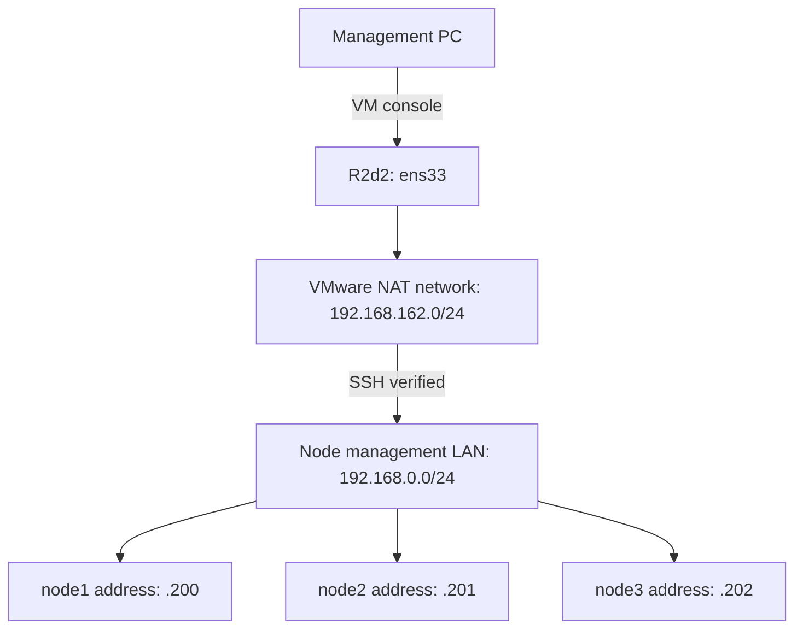

# Chapter A — Install R2d2

[Phase 1](README.md) · [Next: Ubuntu nodes](B-ubuntu-nodes.md)

**Status: complete.** Confirmed from your terminal output on 22 October 2026.

**Purpose:** install the management VM used to download the course and connect to the nodes. These are manual installer steps.

## Installation steps

1. Download [Ubuntu Server 24.04 LTS amd64](https://releases.ubuntu.com/24.04/).
2. Attach the ISO to the management VM and select NAT networking.
3. Install Ubuntu with hostname `r2d2`, account **`joe`**, the VM's intended OS disk and **Install OpenSSH server** selected.
4. Check the disk summary, complete installation, detach the ISO and reboot.
5. Sign in through the VM console.

Initial management-PC access can use the VM console. Direct SSH from the PC depends on the actual VMware networking settings.

## Success check and recorded result

You can sign in at the R2d2 VM console. The following table records the result from the current lab; a rebuild must verify its own result.

| Check | Observed result |
|---|---|
| Hostname and account | `r2d2`, `joe` |
| Operating system | Ubuntu 24.04.5 LTS, x86-64 |
| Virtual machine | VMware; NAT mode stated in the lab plan |
| Network interface | `ens33` |
| IPv4 address | `192.168.162.131/24`, assigned by DHCP |
| Reachability | Ping replies from `192.168.0.200`, `.201` and `.202` |

The exact VMware product is not established by `hostnamectl`. The subsequent [SSH inspection](C-access-check.md) passed on all three nodes. R2d2's configured gateway and DNS are `192.168.162.2`.

## Short lecture — what your result means

R2d2 has an address on `192.168.162.0/24`. Your intended nodes are on `192.168.0.0/24`. Successful pings show that R2d2 can exchange ICMP traffic with those three addresses across the network boundary.

The subsequent SSH inspection connected to port 22, authenticated as `joe` and verified each node's hostname, Ubuntu version and management address.

The diagram shows the logical path. The DHCP address can change; the script records the address actually in use.

**Continue:** [Phase 1 progress and current chapter](README.md).

Reference: [Ubuntu Server installer](https://canonical-subiquity.readthedocs-hosted.com/en/latest/howto/basic-server-installation.html).
