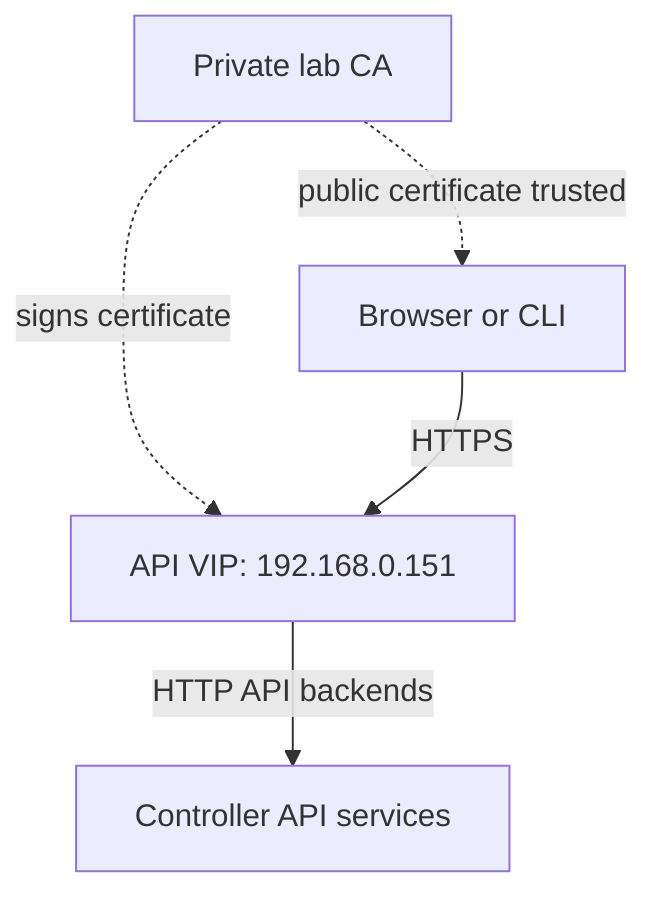

# Chapter E — Configure the lab

[Phase 2](README.md) · [Previous: create the inventory](D-create-inventory.md)

**Goal:** prepare the reviewed settings that Kolla will use during installation.

**Status: completed and reviewed.** Joe's report returned `LAB_CONFIG_PREPARED` on 2026-10-23. The setup commands remain below for rebuilding. The three-compute inventory update passed. Joe confirmed the addresses below are free and chose the simple service baseline with HTTPS.

## 1. Purpose

The inventory says **which machines** to use. Kolla's settings say **how to configure the cloud**: network interfaces, services, storage and access addresses.

## 2. Confirmed inputs

| Setting | Confirmed design |
|---|---|
| Host OS | Ubuntu 24.04 on the three nodes |
| Roles | All three nodes: controller, network, compute and local storage |
| API access address | `192.168.0.151` — one shared internal/public VIP |
| Future VM external pool | `192.168.0.152–192.168.0.199` |
| Management interface | `enp0s31f6` on each node |
| node1 external interface | `enx00e04c557e58` |
| node2 external interface | `enx00e04c2c1678` |
| node3 external interface | `enx00e04c304688` |
| Physical external network | Same untagged LAN through the mini switch and TP-Link router |
| Cinder storage | Separate existing `cinder-volumes` VG on each SATA disk |
| Cinder clustering | Independent backends, empty cluster name; the specific cluster-check exception is approved |

Joe confirmed the VIP and VM pool are free on 2026-10-23. Keep them reserved for this lab. The home DHCP pool is `.2–.150`; nodes use `.200–.202`. This step records the plan; it does not configure router reservations, assign the VIP or create a VM network. A conflict check must still precede deployment.

## 3. Planned steps

1. Review the remaining address and service choices with Joe.
2. Prepare release-compatible inventory host variables and Kolla settings using the confirmed inputs.
3. Explain each setting and any private files that will be created.
4. Preserve existing configuration; show changes before applying them on R2d2.
5. Generate required service credentials privately, following the installed release's procedure.
6. Review the configuration report. Keep passwords, private keys and cloud credentials out of GitHub and shared reports.

## 4. Script and commands

Read [phase2-configure.py](../../scripts/phase2-configure.py). Run it **on R2d2 as joe**. It prepares local files only.

### A. Understand the settings

| Choice | What it means |
|---|---|
| Ubuntu images, OpenStack 2026.2 | Match the selected release and node operating system |
| Management: `enp0s31f6` | Keep the built-in NIC as the management/API path |
| Per-node USB NICs | Store each confirmed USB name in inventory host variables for later external VM traffic |
| Open vSwitch | Retain Kolla 23.0.0's default network implementation |
| Core services + Horizon | Prepare login, images, networking, VMs and the web dashboard |
| Cinder LVM | Use the existing independent `cinder-volumes` pools |
| Heat, Cinder backups, monitoring off | Keep the initial baseline; Terraform and monitoring come in later chapters |
| HTTPS on the shared VIP | Prepare encrypted dashboard/API entry points for `192.168.0.151` |

The previously approved settings remain:

```yaml
cinder_cluster_name: ""
cinder_cluster_skip_precheck: true
```

That is only the agreed cluster-name-check exception for independent LVM backends. Other prechecks remain enabled. It does not replicate disks or create shared storage.

### B. Understand the private files

Everything below is on **R2d2**, under `~/openstack-from-zero/private/phase2/`:

| File or folder | Purpose |
|---|---|
| `kolla/globals.yml` | Kolla's cloud settings |
| `host_vars/node1.yml`, `node2.yml`, `node3.yml` | Each node's external USB NIC name |
| `kolla/lab-network-plan.json` | Record the reserved VIP and future VM address pool |
| `kolla/passwords.yml` | Generated service passwords and internal service keys |
| `kolla/certificates/` | Private lab CA, API certificate and private keys |

The configuration stays in the project's private folder rather than replacing an unknown `/etc/kolla` setup on R2d2. Later Kolla commands must use this configuration directory explicitly with `--configdir`. Service configuration on the nodes is created only during later deployment.

Existing, matching files are reused. An unexpected configuration folder or conflicting settings file is preserved and stops the script. Existing generated passwords and certificates are reused; a rerun does not rotate them.

### C. Understand passwords and HTTPS

**No sudo, node password or SSH-key passphrase is requested.** The script uses the tools already installed in Chapter C.

Kolla's `kolla-genpwd` generates OpenStack's service credentials automatically. These are separate from joe's Ubuntu password and SSH key. Their values are not printed in the report. Do not paste `passwords.yml` or private keys into chat or GitHub.

A **certificate authority (CA)** is a certificate issuer. This script creates a private lab CA and uses it to sign the API certificate. The certificate includes the VIP as an IP address, so no invented DNS name is needed.

- `certificates/ca/lab-root.crt` is the **public CA certificate** that clients will need to trust.
- `certificates/private/` and the `haproxy*.pem` files contain **private keys** and must stay private.
- The API certificate lasts one year; the CA lasts ten years. Renewal is not automatic.
- HTTPS here covers client access to the API load balancer. API backend TLS stays at the release's disabled default; this does not claim every internal connection is encrypted.

The script verifies the certificate signature, key matches, dates and VIP. **It does not yet install CA trust on R2d2 or your browser computer.** Those trust steps must be completed before HTTPS use/deployment checks. A private lab CA is not automatically trusted by browsers.

Planned API access after deployment:



### D. Download and run

These commands enter the repository, download Chapter E and create the explained private files:

```bash
cd ~/openstack-from-zero
git pull --ff-only
/usr/bin/python3 scripts/phase2-configure.py --apply
```

The launcher selects the installed Kolla Python environment automatically. Your terminal can already show `(kolla)`; no extra activation or package installation is needed.

Without `--apply`, the script prints the nonsecret plan and creates no files. You do not need to run both modes.

The script checks the three-node inventory before writing files, generates credentials and certificates privately, then checks that Ansible reads the correct USB NIC for each node. It assigns no addresses, makes no node connections and deploys no services.

## 5. Finish check and lesson

Expected final marker:

```text
RESULT: LAB_CONFIG_PREPARED
```

Use the exact `cat` command printed at the end and send back that report. **Stop before Chapter F.** If the marker is `LAB_CONFIG_NEEDS_REVIEW`, send the report before making further changes. Library error details that might contain credentials are deliberately withheld.

The successful marker means local settings, credential population, certificate checks and inventory NIC mappings passed. It does not mean the VIP is active or HTTPS is available.

Before publication, six regression tests passed. Real Kolla 23.0.0 credential generation, real Ansible 2.21.5 inventory parsing, Kolla playbook syntax checking and OpenSSL certificate-chain/IP verification also passed in an isolated development folder. A second run preserved the generated passwords and keys. No live node or deployed HTTPS test was performed.

### Reviewed result

Joe returned `phase2-config-20261023T185536Z-s1nj1s3p.txt`.

| Check | Observed result |
|---|---|
| Cloud settings and network plan | Prepared privately on R2d2 |
| Three node host-variable files | Prepared; Ansible read each expected external USB NIC |
| Inventory | Expected three-node role mappings passed |
| Service credentials | Populated privately; no values included in the report |
| HTTPS certificate files | Certificate chain, key matches and VIP SAN verified |
| Final checkpoint | `LAB_CONFIG_PREPARED` |

Public CA SHA-256 fingerprint, recorded for later trust verification:

```text
278a4e6a84b761f954b9bbf1f8051c3560b63f0eb073efc9e95d8d1c69df3cbb
```

This is a public certificate fingerprint, not a password or private key. The group-name warnings did not stop inventory parsing; both inventory checks and the final checkpoint passed.

**No IP addresses were assigned, nodes contacted or services deployed by this step.** CA trust installation, active address-conflict checks and live HTTPS verification remain pending. Do not regenerate the credentials or certificates as a default next action.

### Short lecture — after review

`globals.yml` is the cloud's settings sheet. `host_vars` supplies settings that differ by node, such as the USB NIC name. `passwords.yml` holds the services' private credentials.

The API certificate identifies `192.168.0.151`. Our lab CA signs that certificate; a client must trust the CA's **public certificate** to verify the API's identity. Private keys remain on R2d2. Preparing these files does not start a website or make the VIP active.

Chapter F checks the prepared configuration and plans the trust steps before deployment. Three independent LVM backends still do not provide automatic replication.

References: [Kolla 23.0.0 TLS configuration](https://github.com/openstack/kolla-ansible/blob/23.0.0/doc/source/admin/tls.rst) · [Released credential generator](https://github.com/openstack/kolla-ansible/blob/23.0.0/kolla_ansible/cmd/genpwd.py).

[Next planned chapter: validate preparation](F-validate-preparation.md).
