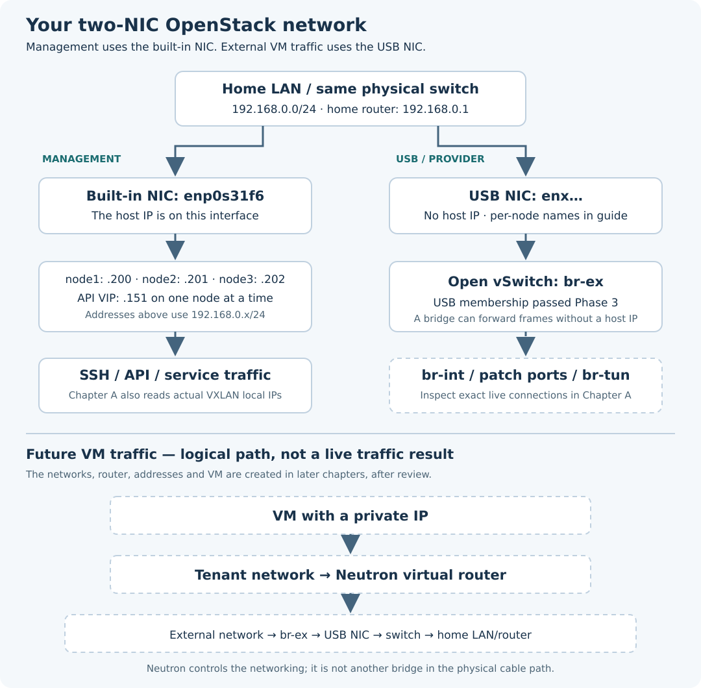

# Chapter A — Understand and inspect the network

[Phase 4](README.md) · [Previous: verified cloud access](../phase-03/D-client-access.md)

**Status: diagram, guide and read-only collector published. Actual Phase 4 network inventory is pending.**

## 1. Purpose

Connect the physical cables to the OpenStack concepts before creating a VM. First collect the real bridge names, ports, tunnel settings, Neutron agents and any existing virtual networks. Then agree the creation plan from that evidence.

## 2. Your diagram, adapted to the two-NIC design



Both physical NICs connect to the **same ordinary switch and home LAN**. The separation is by interface and traffic role; these are not two isolated physical LANs.

| Node | Built-in management NIC and IP | USB external NIC | USB host IP |
|---|---|---|---|
| node1 | `enp0s31f6` — `192.168.0.200/24` | `enx00e04c557e58` | None |
| node2 | `enp0s31f6` — `192.168.0.201/24` | `enx00e04c2c1678` | None |
| node3 | `enp0s31f6` — `192.168.0.202/24` | `enx00e04c304688` | None |

The API VIP is `192.168.0.151`; it was last verified on node2 and can move between nodes. It is separate from VM floating IPs.

Your example used `br-mgmt` and a `veth-host`/`veth-ovs` pair. **The current two-NIC layout does not need that arrangement:** management IPs are directly on `enp0s31f6`, while the separate USB NIC attaches to `br-ex`. This chapter adds no bridge or veth pair.

## 3. What each part means

| Part | Simple meaning |
|---|---|
| `enp0s31f6` | The node's normal host connection: SSH, API and service communication. The inspection also identifies which local IP is used for tunnels. |
| USB NIC | An Ethernet connection for external VM traffic. It does not need its own host IP to forward Ethernet frames. |
| `br-ex` | Open vSwitch's connection to the external physical network through the USB NIC. |
| `br-int` | The OVS integration switch where Neutron-managed ports join the virtual network. Actual port names are collected, not invented. |
| `br-tun` | The OVS tunnel switch in a VXLAN setup. Tunnels can carry private VM traffic between nodes over the configured tunnel IPs. |
| Neutron | OpenStack's network controller. Its agents program switches, DHCP and routing; it is not an extra physical bridge in a cable path. |
| External/provider network | A Neutron network mapped to the physical LAN through a configured physnet and `br-ex`. |
| Tenant network and subnet | The VM's private network and its IP range. No tenant CIDR is selected by this inspection. |
| Virtual router | Connects the tenant subnet to an external network. With IPv4 NAT, private addresses can reach the LAN; a floating IP can map an external address to a VM. |

Kolla's pinned defaults for this approved OVS configuration derive `physnet1:br-ex`, VXLAN tenant networks and legacy L3-agent mode. **Those are source expectations, not a substitute for reading the deployed files.** The collector reads actual bridge mappings, tunnel local IPs, network types, routing mode and `l3_ha` where present. Three L3 agents do not prove router HA is enabled.

For a VM and router on different nodes, private traffic may cross the VXLAN overlay before leaving through the router node's USB NIC. It need not leave through the USB NIC on the VM's own compute node. The later VM test will identify the actual router placement and packet path.

The diagram's lower path is a **logical future flow**, not an exact map of every tap, security-group bridge, router interface or OVS patch port. Those concrete interfaces are documented when the corresponding resources exist.

## 4. Addresses: existing versus not allocated here

| Address or range | Meaning and current scope |
|---|---|
| `192.168.0.1` | Home router; current management default gateway |
| `192.168.0.2–150` | User-confirmed home DHCP range |
| `192.168.0.151` | Existing API VIP |
| `192.168.0.152–199` | Previously agreed proposed external allocation pool; this chapter reserves or allocates none of it |
| `192.168.0.200–202` | Existing node management addresses; exclude from VM allocation |
| Tenant CIDR / VM private IPs | Choose after the inventory and overlap review; not guessed here |

An external address can be used for a router gateway port or a floating IP; it is not an address we put on the USB host interface. The inspection does not prove that unused-looking LAN addresses are free or reserve them on the home router.

## 5. What the read-only command does

Run on **R2d2 as joe**, using the existing inventory, SSH key, local client profile and trusted lab CA.

1. Validate the existing local inputs and reviewed Kolla source. Authenticate with Keystone and read Neutron's existing networks, subnets, routers, ports, agents and floating IPs over HTTPS. The token stays in memory.
2. Connect to node1, node2 and node3 over management SSH. Ask once for each named node's sudo password.
3. Read interface addresses, routes and namespaces; OVS bridges, ports and selected interface/tunnel options; and an allowlist of deployed ML2, OVS-agent and L3-agent configuration fields.
4. Preserve partial observations if one read fails. Full configuration files, authentication sections, database connection URLs and SSH keys are not copied into the report.
5. Save one combined private report on R2d2. Check that the private deployment inputs remain unchanged.

Normal SSH/Ansible temporary files and authentication/log activity are expected. The command installs no packages, changes no saved node settings, restarts no services, creates no cloud resources and performs no LAN allocation or VM traffic test. Existing networks are inventoried, not removed or required to be empty.

## 6. Run — on R2d2 as joe

```bash
cd ~/openstack-from-zero
git pull --ff-only
/usr/bin/python3 scripts/phase4-network-check.py --run
```

Enter the existing SSH-key passphrase if requested. At `Joe sudo password on node1:` / `node2:` / `node3:`, enter the password for that named node. Typing is invisible; press Enter. Enter passwords in the terminal only.

Without `--run`, the script prints its plan and makes no connections or files.

## 7. Return the report and stop before creation

Use the exact `cat` command printed at the end. If terminal copying truncates the output, attach the actual report file from the printed path instead of another partial terminal paste. Keep it out of GitHub.

Expected collection marker:

```text
RESULT: NETWORK_INSPECTION_COLLECTED for all
```

This means the inventory and intended host-layout observations were collected without the reported collection/layout issues. It does **not** mean a VM has internet connectivity, that every Neutron agent is healthy or that proposed LAN allocations are free. We review the agent states and objects before preparing Chapter B.

If it says `NETWORK_INSPECTION_NEEDS_REVIEW`, return the report before changing anything. No automatic repair or retry runs.

## 8. Finish check and short lesson

- [x] Phase 3 API access and Horizon login completed.
- [x] Two-NIC diagram and read-only procedure prepared.
- [ ] Actual Phase 4 network inspection reviewed.
- [ ] Network names, tenant CIDR, external allocation details and creation scope agreed before Chapter B implementation.

After the report, identify the difference between a physical NIC, an OVS bridge, a Neutron network, an IP subnet and a virtual router using the actual names in the lab. This is the checkpoint before adding virtual networking.

**Local validation:** nine regression tests cover plan isolation, authenticated API reads/pagination, configuration and OVS-option filtering, identity guards, partial evidence, all-three-node collection and password privacy. The installed Ansible accepts the generated playbook's syntax and task list. Deployed configuration filenames were checked against the pinned Neutron role. These are development checks; the actual nodes and API inventory remain live checks for Joe's run.

Sources: [Neutron OVS self-service architecture](https://docs.openstack.org/neutron/latest/admin/deploy-ovs-selfservice.html) and pinned Kolla source for [network defaults](https://github.com/openstack/kolla-ansible/blob/4b493ef36ace2b90257ecf94feb00e2c6e8014c9/ansible/group_vars/all/neutron.yml) and [OVS-agent bridge mapping](https://github.com/openstack/kolla-ansible/blob/4b493ef36ace2b90257ecf94feb00e2c6e8014c9/ansible/roles/neutron/templates/openvswitch_agent.ini.j2). These source examples do not authorize running their installation or network-creation commands at this inspection stage.
