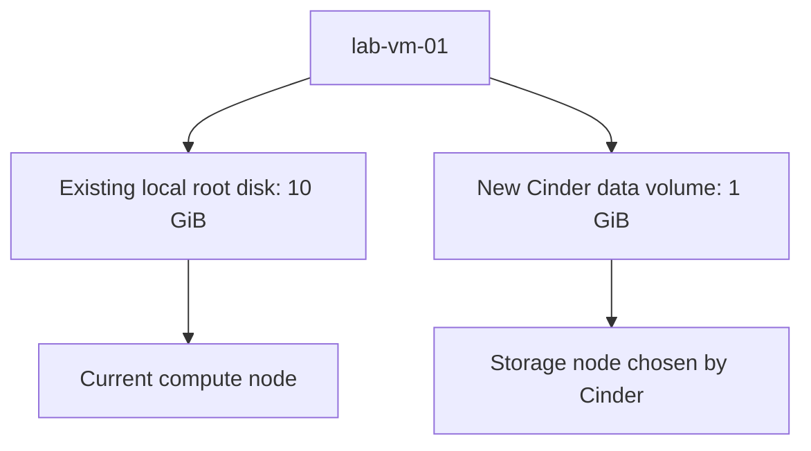

# Chapter E — Attach a data volume and verify persistence

[Phase 4](README.md) · [Previous: VM networking](D-boot-and-test-vm.md) · [Viewing commands](../command-glossary.md)

**Status: prepared and locally tested; live volume result pending.** Chapter D's reviewed live report passed VM boot, SSH, DHCP, metadata, DNS, outbound HTTPS and floating-IP ping. The VM was on node1; the active router was on node3. Scripts read current IDs and placement rather than assuming those snapshots remain current.

## 1. Two disks, two purposes

A Cinder volume is an additional virtual disk. Think of adding a second virtual disk to a VMware VM.

| Disk | Purpose | This chapter |
|---|---|---|
| Existing 10 GiB root disk | Ubuntu and its system files, on the compute node | Kept intact |
| New 1 GiB data volume | A small independent data disk managed by Cinder | Create, attach, format, mount and test |

**1 GiB is disk capacity, not RAM.** The volume occupies one storage backend; Cinder selects that backend. It can be on the same node as the VM or another node. The report shows both locations.



The compute host accesses the Cinder LVM volume through iSCSI. The drawing shows storage relationships, not a packet capture. Independent LVM pools are **not replicated storage HA**. This chapter adds no Ceph or automatic VM recovery.

## 2. What formatting and mounting mean

**Formatting** creates an ext4 filesystem: the structure Linux needs to store directories and files. **Mounting** makes that filesystem accessible at a directory, here `/mnt/lab-data`.

The script does not assume that the new disk is `/dev/vdb` or `/dev/sdb`:

1. Read the guest's original disk list and identify its root filesystem before attaching anything.
2. Create one uniquely tracked `lab-data-01` volume and attach it to the existing tracked VM.
3. Match exactly one newly appeared disk's serial to Cinder's volume UUID. Virtio may expose the UUID's first 20 characters; the original disk baseline, unique match and exact 1 GiB capacity must agree too.
4. Reject original disks, unexpected partitions/devices, mounted disks, swap, active holders and filesystem signatures. Read the entire new disk and require zero-filled content.
5. Format only that identified blank data disk. Create no partition table and never run a forced format.

Unexpected evidence stops the script for review. It does not erase existing data to make a disk qualify.

## 3. What the persistence test does

| Step | Action | Evidence |
|---|---|---|
| Prepare | Check VM identity, trusted SSH key, guest tools, Cinder services/pools/type and quotas | Known working VM and suitable LVM backend |
| Attach | Create one 1 GiB volume and attach it through Nova | Cinder and Nova agree on the volume and VM IDs |
| Initialize | Perform the disk checks above; create ext4 and mount it | Known filesystem UUID and correct device |
| Write | Create `/mnt/lab-data/persistence-test.txt`; flush its bytes | Save its SHA256 checksum |
| Detach | Flush/unmount; confirm it is unmounted; ask Nova to detach | Volume becomes available and disk disappears from the guest |
| Reattach | Attach the same volume; identify it again; mount the existing filesystem | Same volume and filesystem UUID; no second format |
| Verify | Read the test file again | Same contents and SHA256 checksum |

A checksum is a fingerprint of the file's bytes. Matching checksums and exact content before/after show that the data survived this detach/reattach exercise.

The guest helper uses `ubuntu` SSH key login and `sudo -n`. It changes only the new data filesystem, its mount directory and test file. It does not install packages, change `/etc/fstab`, reboot the VM, touch node VGs or edit OpenStack configuration. Existing packages must supply the required tools.

## 4. Review the plan — run on R2d2 as joe

```bash
cd ~/openstack-from-zero
git pull --ff-only
/usr/bin/python3 scripts/phase4-volume.py
```

Default mode prints the plan without connections, files or resource changes.

Read the scope above before applying: **the command formats the newly created and verified blank data volume**, then runs the complete persistence test.

## 5. Apply and verify

On R2d2:

```bash
/usr/bin/python3 scripts/phase4-volume.py --apply
```

If requested, enter the existing **guest SSH-key passphrase** from Chapter C. Typing is hidden; no physical-node sudo password is expected. The SSH host key must match Chapter D's private pinned identity; this command does not replace that trust.

Keep the terminal open. API waits and guest-device visibility checks are bounded. API/guest state that does not meet the checks is reported rather than automatically repaired.

The result should end with:

```text
RESULT: CINDER_VOLUME_PERSISTENCE_VERIFIED
```

Use the exact `cat` command printed at the end and return that report. It includes the actual volume ID, storage backend/node, compute host, guest device, filesystem UUID and checksum evidence.

## 6. What remains afterward

- The same volume remains **attached and mounted** at `/mnt/lab-data`.
- The root-owned test file remains in that filesystem; the VM continues running.
- Nova's attachment is explicitly configured to retain the volume if the VM is deleted. Deleting a VM is not part of this chapter.
- No persistent mount entry is added. After a guest reboot, do not assume that `/mnt/lab-data` is mounted; reboot/mount configuration is a separate exercise.
- The local root disk and the Cinder data volume remain separate. A data volume does not convert this VM into a boot-from-volume VM.

A later repeat of `--apply` on a completed exercise checks the tracked volume; it does not format it or repeat detach/reattach. Explicit verification mode reads the completed mounted volume without create, attach, detach, format or mount commands:

```bash
/usr/bin/python3 scripts/phase4-volume.py --verify
```

Private tracking is `private/phase4/volume.json`. It records each confirmed checkpoint and a pending marker before mutations. If an operation's outcome is uncertain, the marker prevents repetition. On `CINDER_VOLUME_NEEDS_REVIEW`, return the report; do not remove the marker/state or run manual format/force-detach commands. No automatic cleanup or deletion occurs. Normal reads/probes can generate logs and filesystem access metadata.

## 7. View it yourself

On R2d2:

```bash
/usr/bin/python3 scripts/lab-view.py volumes
/usr/bin/python3 scripts/lab-view.py servers
```

In Horizon: **Project → Volumes → Volumes** shows the volume and attachment. **Project → Compute → Instances** shows the VM. Browser sign-in is a separate user-confirmed check.

From your existing SSH session **inside the VM**, these commands only inspect:

```bash
lsblk -o NAME,SIZE,TYPE,FSTYPE,MOUNTPOINTS,SERIAL
findmnt --mountpoint /mnt/lab-data
sudo cat /mnt/lab-data/persistence-test.txt
sudo sha256sum /mnt/lab-data/persistence-test.txt
```

`lsblk` lists disks, `findmnt` shows the mounted filesystem, `cat` reads the file, and `sha256sum` prints its fingerprint. Do not copy a device name from an example into a format command.

## 8. What this proves and the agreed sequence

A passed report proves this one volume's attachment, filesystem operation and data persistence across a safe detach/reattach. It does **not** prove survival of a storage-node failure, replication, backup, reboot persistence, migration or automatic VM recovery.

The learning order remains:

1. Finish and review this Cinder volume report.
2. Prepare separate controlled API VIP, MariaDB and virtual-router HA tests. Explain each interruption and restoration, then obtain approval before fault injection.
3. Inspect prerequisites/capacity and prepare a planned VM migration between healthy compute nodes.
4. Assess HA storage/Ceph and automatic VM recovery later. No reinstall is needed for this chapter.

## Local validation and limits

Tests simulate the full lifecycle, interrupted writes, duplicate resources, identity drift, quota gates, root-disk protection, serial matching, zero-data checks, safe unmount and checksum verification. A disposable regular image file is formatted with the exact ext4 options and exercised using local filesystem tools; no host block device or mounted lab disk is used. These are local tests, not a real Cinder attachment, iSCSI connectivity test or live data-persistence result. Joe's live report supplies that evidence.

[Volume API](https://docs.openstack.org/api-ref/block-storage/v3/) · [Nova volume attachments](https://docs.openstack.org/api-ref/compute/) · [Cinder LVM driver](https://docs.openstack.org/cinder/latest/configuration/block-storage/drivers/lvm-volume-driver.html)
