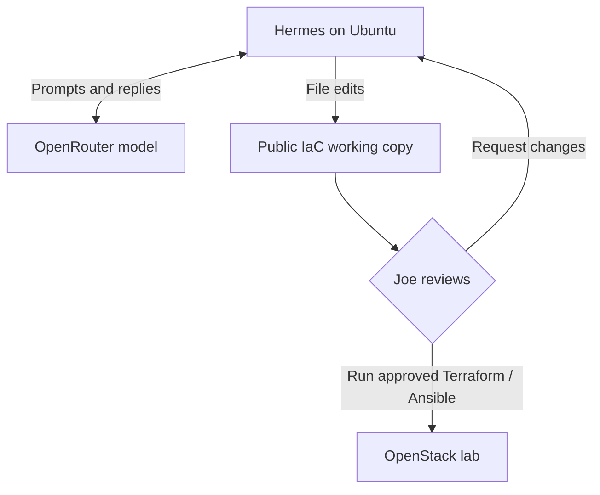

# Phase 8 — Hermes with OpenRouter

[Home](../../README.md) · [Course plan](../00-goal-and-plan.md) · [AI rules](../../AI/HERMES-IAC-RULES.md)

**Goal:** use Hermes to help write Terraform, Ansible and documentation. **You review and run the infrastructure commands.** Terraform is paused at Phase 6 Chapter C; this guide does not create or change OpenStack resources.

Hermes runs on Ubuntu. OpenRouter connects it to the model you select. The model runs remotely, so this setup does not require a local model or GPU.



## A — Choose the host and account

Use **R2d2 or a separate Ubuntu 24.04 machine**. Confirm your choice before running the installation steps. This guide uses a new, unprivileged Linux account named `hermes-iac` on that selected machine. Do not install it on node1, node2 or node3.

| Location | Used for |
|---|---|
| Your normal administrator terminal | Install prerequisites and create the account |
| `hermes-iac` terminal | Install Hermes, enter its OpenRouter key and use its public working copy |
| Joe's normal R2d2 terminal | Keep cloud credentials/state, review changes and run Terraform/Ansible |

First, in the selected machine's normal administrator terminal:

```bash
hostname
free -h
df -h "$HOME"
```

Read **available** RAM and **Avail** disk space before adding the application. They are current measurements, not reservations. An existing Hermes installation in your normal account does not replace the separate account used below; inspect an existing `hermes-iac` account before reusing it.

## B — Prepare Ubuntu

Run these commands as the machine's normal administrator, such as `joe` on R2d2:

```bash
sudo apt update
sudo apt install -y git curl ca-certificates tar unzip build-essential pkg-config python3-dev libssl-dev libffi-dev libatomic1
sudo adduser --disabled-password --gecos "Hermes IaC assistant" hermes-iac
id hermes-iac
```

The account must not belong to `sudo`, `docker` or `lxd`. Its password is disabled; you enter it through your existing administrator account. Do not copy SSH keys, OpenStack profiles, Terraform state or private reports into it.

On **R2d2**, check that the new account cannot read Joe's management key or cloud profile:

```bash
if sudo test -f /home/joe/.ssh/openstack-from-zero && \
   sudo test -d /home/joe/openstack-from-zero/private; then
sudo -u hermes-iac bash -c '
for lab_path in /home/joe/.ssh/openstack-from-zero /home/joe/openstack-from-zero/private; do
  if test -r "$lab_path"; then
    printf "STOP: hermes-iac can read %s\n" "$lab_path"
    exit 1
  fi
done
if test -x /home/joe/openstack-from-zero/private; then
  printf "STOP: hermes-iac can traverse Joe private directory\n"
  exit 1
fi
printf "PASS: Joe management files are not readable by hermes-iac\n"
'
else
  printf 'STOP: the reviewed Joe paths are missing; check the actual locations.\n' >&2
  false
fi
```

Require the `PASS` result. A missing path or readable management file prints `STOP`. Do not loosen permissions on Joe's home, `private/` directory or SSH keys to make files available to Hermes.

Enter the new account:

```bash
sudo -iu hermes-iac
whoami
```

**Expected: `hermes-iac`.** Keep using this account through steps C–G.

## C — Install the reviewed Hermes release

This guide uses **Hermes v0.22.5**, commit `bf0203a794a07aac3ff764972ab9087baa4e4f4e`. The official installer manages its Python/tool environment; do not install it inside the Kolla or OpenStack-client environment.

Download the installer from that exact upstream revision:

```bash
curl --proto '=https' --tlsv1.2 -fsSL \
  https://raw.githubusercontent.com/NousResearch/hermes-agent/bf0203a794a07aac3ff764972ab9087baa4e4f4e/scripts/install.sh \
  -o "$HOME/install-hermes.sh"
```

Run it **without sudo**:

```bash
bash "$HOME/install-hermes.sh" \
  --commit bf0203a794a07aac3ff764972ab9087baa4e4f4e \
  --non-interactive --skip-browser --skip-computer-use
```

This installs the pinned CLI and its managed dependencies. It skips interactive onboarding and browser/computer-use downloads. A desktop app and messaging gateway are not installed or started by these commands. Initial downloads can take several minutes; the installer prints its current stage.

Make the command available in this terminal and check it:

```bash
export PATH="$HOME/.local/bin:$PATH"
hermes --version
git -C "$HOME/.hermes/hermes-agent" rev-parse HEAD
```

Expected: version **0.22.5** and the exact commit above. Hermes settings and its OpenRouter key belong in this account's `~/.hermes/`; the command launcher is `~/.local/bin/hermes`.

## D — Connect OpenRouter

In your browser:

1. Open [OpenRouter API keys](https://openrouter.ai/keys) and sign in.
2. Create a key named, for example, `hermes-iac`.
3. Set a spending limit you choose. Check the selected model's pricing and your account credit balance.
4. Copy the key privately. Do not put it in this repository or paste it into a chat/report.

Back in the **hermes-iac terminal**:

```bash
hermes model
```

Use the interactive picker:

| Prompt | Select or enter |
|---|---|
| Provider | **OpenRouter** |
| Authentication | API key, when offered |
| `OPENROUTER_API_KEY` | Paste the copied key and press Enter |
| Model | A tool-capable model you approve after checking its price/context window |

At a hidden key prompt, pasted characters may not appear. That is normal; paste once and press Enter. Pressing Enter with no key cancels that entry. Enter the key at the provider prompt, not as a Linux command and not in a Hermes chat message.

Use the live model picker rather than an invented model name. OpenRouter's Hermes guide recommends at least **64K context** for typical configurations. Record the exact selected model ID so you can reproduce your choice.

Check the saved selection:

```bash
hermes config get model.provider
hermes config get model.default
```

Expected: provider `openrouter` and your chosen model ID. These commands check configuration; the first chat below verifies authentication and a real response. Model requests use your OpenRouter account and may consume credits.

## E — Prepare the public IaC workspace

Still as **hermes-iac**:

```bash
mkdir -p "$HOME/work"
git clone https://github.com/DinosaurKeys/openstack-from-zero.git "$HOME/work/openstack-from-zero"
cd "$HOME/work/openstack-from-zero"
```

This is a new public clone, separate from Joe's `/home/joe/openstack-from-zero`. Keep it free of `private/`, `reports/`, cloud credentials, SSH private keys and Terraform state. Repository context sent to the model goes through OpenRouter.

Set the CLI tools interactively:

```bash
hermes tools
```

Choose the **CLI** platform. Use the displayed menu controls to leave only these three enabled, then save:

| Enabled | Purpose |
|---|---|
| File Operations | Read, write, patch and search code |
| Skills | Read/manage skill documents |
| Clarifying Questions | Ask you for missing information |

Leave terminal/processes, code execution, delegation, browser/web, computer use, connectors/MCP, messaging and cron disabled. Do not add plugins, connectors, hooks or an SSH backend in this phase. Their execution/network capabilities need a separate design.

## F — Check and start the controlled session

From the public workspace:

```bash
bash scripts/hermes-iac.sh --check
```

Expected:

```text
RESULT: HERMES_LAUNCHER_CHECK_PASSED
```

This checks the account, workspace and installed source pin. It does not send a model request or verify your API key.

Start Hermes:

```bash
bash scripts/hermes-iac.sh
```

The launcher selects OpenRouter and exactly `file,skills,clarify`, uses the local filesystem, removes inherited OpenStack/Git authentication variables and limits `write_file`/`patch` to the public copy's `terraform/`, `ansible/`, `docs/` and `AI/` areas. The `ansible/` path is reserved for the later application work. Git metadata, the launcher and agent settings are outside those write roots. The first prompt loads the [IaC rules](../../AI/HERMES-IAC-RULES.md) and [learning guide](../../AI/HERMES-LEARNING-GUIDE.md), asks for a short role summary, then waits.

Inside Hermes, enter:

```text
/tools
```

Check the actual displayed tools. Require File Operations, Skills and Clarifying Questions only; no terminal/process, `execute_code`, delegation or network/infrastructure tool. A model's statement that it is restricted is not proof; inspect the runtime tool list. Exit and review if it differs.

**Important boundary:** tool selection and the write-root setting are application controls, not a firewall. The separate Linux account protects files according to Linux permissions. This guide does not claim to block all SSH, Telnet or LAN traffic at the operating-system level. Enforced network isolation requires a separately reviewed host/firewall setup.

## G — First useful test

Ask Hermes:

```text
Read AI/HERMES-IAC-RULES.md and AI/HERMES-LEARNING-GUIDE.md.
Explain terraform/phase6/main.tf in five short bullets.
Do not edit files or run commands.
```

**Expected:** an explanation of the two VMs, access rules, floating IP and data volume. It should perform file reads and explanation only. No Terraform/OpenStack/SSH command should run.

For a first file-writing test:

```text
Propose a short AI/first-review.md explaining the Phase 6 resources.
Show the proposed scope and wait for my approval before writing it.
```

After you approve, require a file-change result from the file tool. Review the actual file; do not rely only on the assistant's closing summary. Keep the first exercise to documentation.

## H — Everyday use and review

Start from your normal administrator terminal on the chosen host:

```bash
sudo -iu hermes-iac
cd "$HOME/work/openstack-from-zero"
bash scripts/hermes-iac.sh
```

Use `Ctrl+D` to leave the chat. At the Linux prompt, review changes yourself:

```bash
git status --short
git diff --stat
git diff --check
git diff
```

Then type `exit` at the Linux prompt to return to your normal account. Review the proposal before transferring selected changes into the management repository. Validate and plan with your normal R2d2 tools and privately selected cloud identity. Hermes does not commit, push, run Terraform/Ansible or operate the lab in this workflow. A complete repository rebuild or AI-operated cloud control remains outside this phase.

Updates are maintenance actions: `hermes update` may change the reviewed release, so the launcher will require a version review afterward. Do not delete the Hermes data directory or Joe's Terraform state to update a tool.

## Completion and sources

Phase 8 is verified after the pinned installation, a real OpenRouter response, the runtime tool-list check and the reviewed file exercise pass on your host. The launcher passed **11 local fixture tests**. Its chat/model/tools/config commands were parsed with the pinned upstream CLI parsers, the installer options were checked against the pinned script, and the three built-in toolsets were checked against the source registry. No installation or paid model request was performed by the assistant; those live results remain pending.

This follows the [old repo's AI concept](https://github.com/DinosaurKeys/openstack-zero-to-hero/tree/main/AI), with current paths and no copied historical workload results.

[Hermes v0.22.5](https://github.com/NousResearch/hermes-agent/releases/tag/v0.22.5) · [Pinned installer](https://github.com/NousResearch/hermes-agent/blob/bf0203a794a07aac3ff764972ab9087baa4e4f4e/scripts/install.sh) · [Installation and non-sudo accounts](https://github.com/NousResearch/hermes-agent/blob/v0.22.5/website/docs/getting-started/installation.md) · [Pinned CLI options](https://github.com/NousResearch/hermes-agent/blob/v0.22.5/hermes_cli/_parser.py) · [Toolsets](https://github.com/NousResearch/hermes-agent/blob/v0.22.5/toolsets.py) · [File-write guard limits](https://github.com/NousResearch/hermes-agent/blob/v0.22.5/website/docs/user-guide/security.md#file-write-safety) · [Official OpenRouter setup guide](https://openrouter.ai/blog/tutorials/hermes-agent/)

**Next:** return the installation version, selected provider/model, tool-list check and first-test result. Keep keys and private data out of the response. Resume the paused Terraform chapter when you choose; monitoring is now planned as Phase 9.
